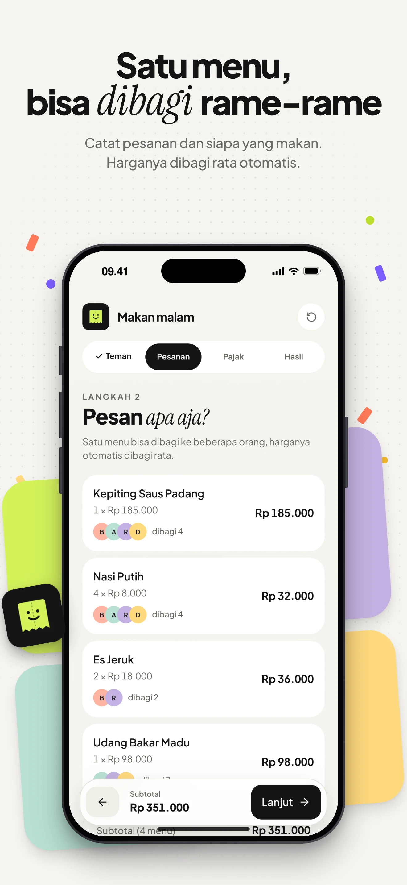
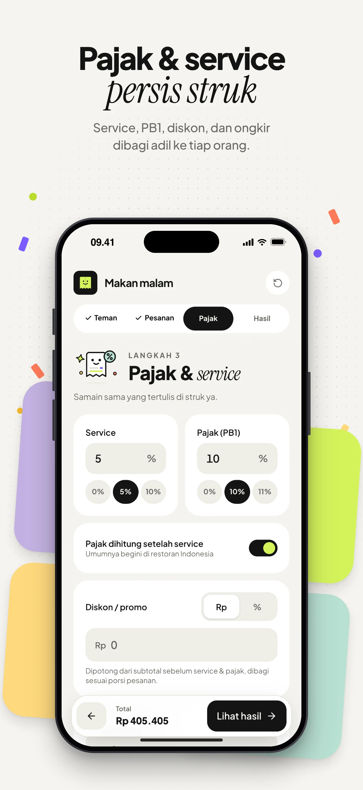
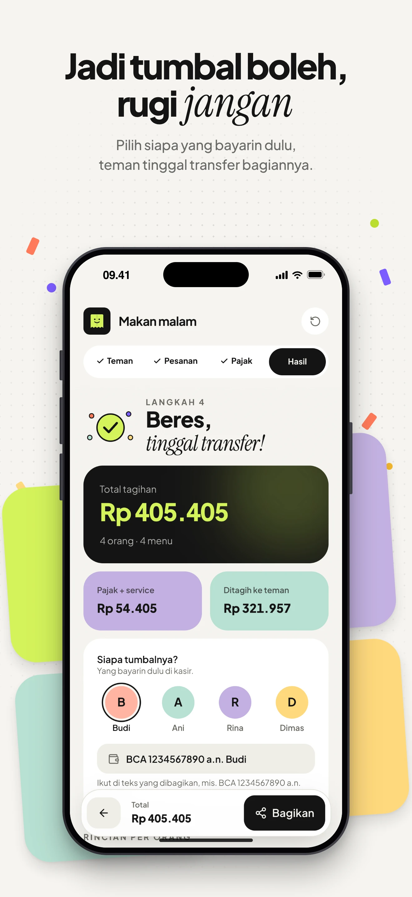
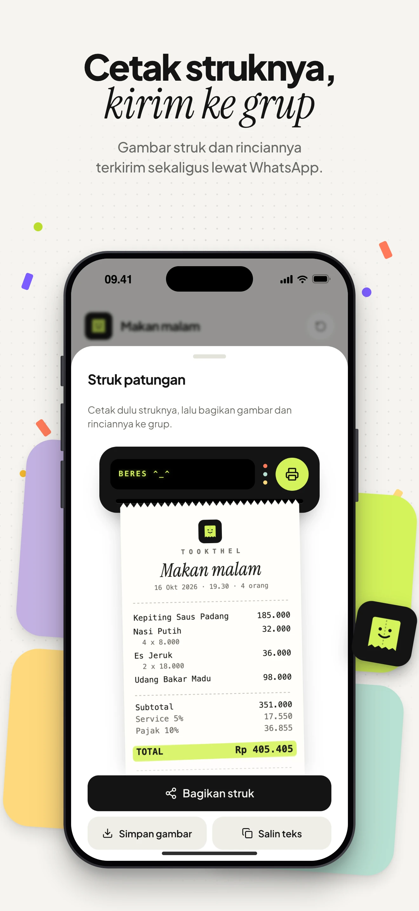
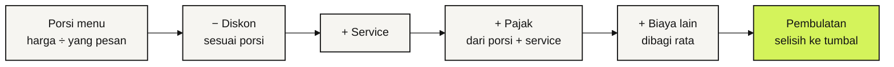
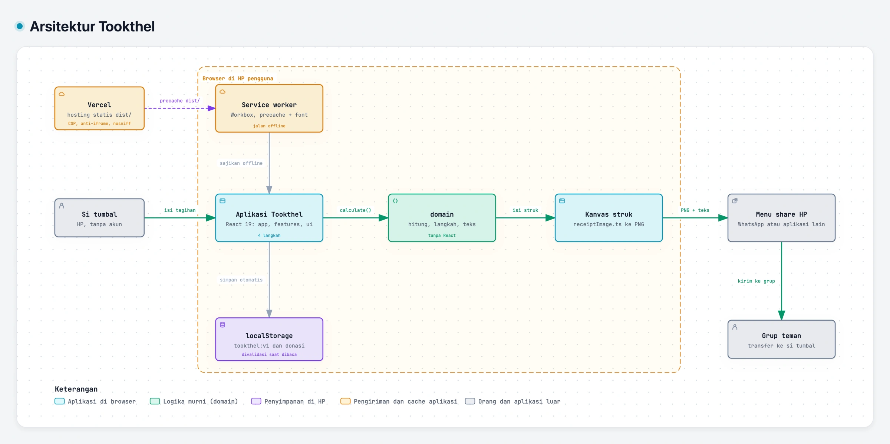

<!-- markdownlint-disable MD001 MD013 MD033 MD041 -->

<div align="center">


# Tookthel

**Jadi tumbal boleh, rugi jangan.**

Bagi tagihan nongkrong lengkap dengan pajak, service, dan diskon, lalu kirim struknya ke grup.<br />
Langsung jalan di browser HP, tanpa akun, dan tetap bisa dipakai tanpa internet.

### [Coba di tookthel.vercel.app](https://tookthel.vercel.app)

[](https://tookthel.vercel.app)
[](https://github.com/bintangfabian/tookthel/actions/workflows/ci.yml)
[](#fitur)
[](https://react.dev)
[](https://www.typescriptlang.org)
[](https://vite.dev)
[](https://tailwindcss.com)

</div>

> [!NOTE]
> **Tookthel 1.0 sudah rilis di [tookthel.vercel.app](https://tookthel.vercel.app) sejak 16 Oktober 2026.**
> Vercel men-deploy `main` ke produksi dan membuat preview untuk setiap PR. Tidak ada server dan database: semua tagihan tersimpan di perangkat pengguna.

<p align="center">
  
  
  
  
</p>

## Kenapa Tookthel

Tiap nongkrong selesai, semua mendadak sibuk sendiri pas bill datang. Ujung-ujungnya selalu ada satu orang yang jadi tumbal: bayarin dulu di kasir, lalu nagih satu per satu. Dia *took the L*.

Tookthel bikin si tumbal tetap balik modal. Masukkan siapa yang ikut dan apa yang dipesan, lalu pajak, service, dan diskonnya dibagi adil per orang. Hasilnya dicetak jadi struk dan tinggal dikirim ke grup.

## Fitur

- **Empat langkah, satu layar HP.** Teman, Pesanan, Pajak, dan Hasil. Langkah berikutnya baru terbuka kalau yang sebelumnya sudah lengkap, dan alasannya langsung terlihat.
- **Menu bisa dibagi.** Harga menu dibagi rata di antara orang yang memesannya. Pesanan tanpa pemesan ditandai sebelum lanjut.
- **Service, pajak (PB1), diskon, dan biaya lain.** Service, pajak, dan diskon bisa persen atau nominal Rp persis seperti di struk, dan pajak persen bisa dihitung sebelum atau sesudah service.
- **Pembulatan per orang** ke Rp 100, 500, atau 1.000 supaya gampang ditransfer. Selisihnya ditanggung si tumbal, jadi totalnya tetap sama dengan struk.
- **Struk yang dicetak.** Tombol Bagikan membuka printer kecil yang mencetak struk. Gambar struk dan teks rinciannya terkirim sekaligus lewat menu share HP. Di laptop, gambarnya diunduh dan teksnya disalin.
- **Rekening si tumbal ikut terkirim**, jadi teman bisa langsung transfer tanpa bertanya.
- **Bisa diurungkan.** Orang, pesanan, dan tagihan yang terhapus bisa dikembalikan dari notifikasi.
- **PWA.** Bisa dipasang di layar utama HP, tetap jalan tanpa internet setelah dibuka sekali, dan mengikuti mode gelap HP.
- **Privat.** Tanpa akun, tanpa server, dan tanpa request ke pihak ketiga. Tagihan hanya disimpan di perangkat.

## Cara pakai

1. Buka [tookthel.vercel.app](https://tookthel.vercel.app) dan tulis nama teman yang ikut. Orang pertama otomatis jadi tumbal.
2. Tambah pesanan: nama menu, harga satuan, jumlah, dan siapa saja yang makan. Ketuk **Semua** kalau menunya dimakan bareng.
3. Samakan service, pajak, diskon, dan ongkir dengan struk restoran. Pilih pembulatan kalau mau.
4. Di **Hasil**, pilih siapa tumbalnya dan isi rekening atau e-wallet-nya.
5. Ketuk **Bagikan**, cetak struknya, lalu **Bagikan struk** ke grup WhatsApp.

## Cara hitung

Urutannya mengikuti struk restoran di Indonesia, dihitung per orang:



- Diskon, service, dan pajak dibagi **proporsional** sesuai porsi pesanan tiap orang.
- Biaya lain (misalnya ongkir) dibagi **rata** ke semua orang.
- Pajak bisa dihitung dari porsi saja kalau saklar "Pajak dihitung setelah service" dimatikan. Saklar ini hanya untuk pajak persen, karena pajak nominal sudah final dari struk.
- Tagihan selain si tumbal dibulatkan, dan si tumbal menanggung sisanya. Totalnya selalu sama persis dengan struk.

**Contoh** dari gambar di atas: makan malam berempat, service 5%, pajak 10%, dan Budi yang bayar duluan.

| Orang | Porsi menu | Service 5% | Pajak 10% | Ditagih |
| --- | ---: | ---: | ---: | ---: |
| Ani | 86.916,67 | 4.345,83 | 9.126,25 | **Rp 100.389** |
| Rina | 104.916,67 | 5.245,83 | 11.016,25 | **Rp 121.179** |
| Dimas | 86.916,67 | 4.345,83 | 9.126,25 | **Rp 100.389** |
| Budi (tumbal) | 72.250,00 | 3.612,50 | 7.586,25 | **Rp 83.448** |
| **Total** | **351.000** | **17.550** | **36.855** | **Rp 405.405** |

Tagihan Ani, Rina, dan Dimas dibulatkan ke rupiah terdekat, sedangkan Budi menanggung sisanya supaya totalnya tetap Rp 405.405. Logikanya ada di [`src/domain/calculate.ts`](src/domain/calculate.ts), dan setiap aturan di atas punya unit test di [`calculate.test.ts`](src/domain/calculate.test.ts).

## Cara kerja

<sub>KODE → DIAGRAM · Peta sistem yang menaut ke baris kodenya</sub>

<a href="https://bintangfabian.github.io/tookthel/arsitektur.html">
<picture>
  <source media="(prefers-color-scheme: dark)" srcset="docs/gambar/arsitektur-gelap.webp" />
  
</picture>
</a>

**[Buka diagram interaktif ↗](https://bintangfabian.github.io/tookthel/arsitektur.html)** · [telusuri jalur sampai grup ↗](https://bintangfabian.github.io/tookthel/arsitektur.html#route=pengguna~teman) · [sumber JSON](docs/arsitektur.archify.json)

- **Tanpa server.** Seluruh aplikasi jalan di browser. Vercel hanya menyajikan berkas statis hasil build.
- **Hitungan murni di `domain`.** Komponen hanya menampilkan data dan mengirim aksi. `domain` tidak mengenal React, jadi setiap aturan hitung bisa dites dengan unit test biasa.
- **Struk digambar di `<canvas>`.** Data dari `buildReceipt()` digambar oleh [`receiptImage.ts`](src/features/result/receiptImage.ts), dan gambar yang keluar dari printer sama persis dengan yang terkirim ke grup.
- **Bagikan lewat menu share HP.** Web Share API mengirim gambar dan teks sekaligus. Kalau perangkat tidak bisa berbagi file, gambarnya diunduh dan teksnya disalin.
- **Tersimpan di perangkat.** Tagihan dan status ajakan traktir disimpan di localStorage, lalu divalidasi oleh `restoreBill()` setiap kali dibaca.
- **Offline.** Service worker Workbox men-precache semua aset, termasuk font, setelah aplikasi dibuka sekali.

Aturan import antar-layer ada di [`AGENTS.md`](AGENTS.md#6-arsitektur):

| Layer | Isi | Contoh |
| --- | --- | --- |
| `domain` | Logika murni: hitung tagihan, syarat tiap langkah, isi struk, teks bagikan, validasi data tersimpan | `calculate()`, `stepBlocker()`, `buildReceipt()`, `restoreBill()` |
| `state` | Reducer tagihan dan penyimpanan `localStorage` | `billReducer`, `useBill()` |
| `lib` | Utilitas umum tanpa pengetahuan soal tagihan | `rupiah()`, `wrapText()` |
| `ui` | Komponen dasar, ilustrasi berwajah, dan logo | `Button`, `Sheet`, `Printer` |
| `features` | Satu folder per langkah, menyambungkan `ui` dengan data tagihan | `ItemsStep`, `PrintSheet` |
| `app` | Komposisi halaman | `App`, `BottomBar` |

## Mulai lokal

Butuh Node.js 22 atau lebih baru.

```sh
git clone https://github.com/bintangfabian/tookthel.git
cd tookthel
npm install        # sekalian mengaktifkan hook git
npm run dev        # http://localhost:5173
```

Tidak ada `.env` yang perlu diisi. Untuk mencoba dari HP di jaringan yang sama, jalankan `npm run dev -- --host`.

| Perintah | Fungsi |
| --- | --- |
| `npm run dev` | Server development |
| `npm run build` | Build production + PWA ke `dist/` |
| `npm run preview` | Menyajikan hasil build secara lokal, dengan header keamanan yang sama seperti produksi |
| `npm run typecheck` | Cek tipe TypeScript |
| `npm run lint` | Lint (oxlint), warning dianggap gagal |
| `npm run knip` | Cari berkas, export, dan dependensi yang tidak terpakai |
| `npm test` | Unit test (Vitest) |
| `npm run test:e2e` | E2E di browser HP (Playwright), build production dulu otomatis |
| `npm run icons` | Buat ulang favicon dan ikon PWA dari `public/logo.svg` |

Pertama kali menjalankan E2E di mesin baru: `npx playwright install --only-shell chromium`.

## Struktur

```text
tookthel/
├── src/
│   ├── domain/        # logika murni + unit test di sebelahnya
│   ├── state/         # reducer, localStorage, useBill
│   ├── lib/           # format rupiah, pecah teks, id
│   ├── ui/            # komponen dasar, ilustrasi, logo
│   ├── features/      # people, items, charges, result
│   └── app/           # App, header, navigasi, bar bawah
├── e2e/               # skenario Playwright di viewport HP
├── public/            # logo, favicon, ikon PWA
├── docs/              # diagram arsitektur interaktif dan gambar README
├── scripts/           # cek atribusi AI, gambar promo README
├── AGENTS.md          # aturan kerja untuk manusia dan AI agent
└── vercel.json        # rewrite SPA, service worker tanpa cache, header keamanan
```

## Gerbang mutu

CI di GitHub Actions jalan di setiap PR dan setiap push ke `main`:

| Workflow | Isi |
| --- | --- |
| **CI** | Typecheck, lint (oxlint), knip, unit test (Vitest), dan E2E Playwright di viewport HP pada build production: alur lengkap, struk, layar 320 px, header keamanan, dan CSP. |
| **No AI attribution** | Menolak atribusi AI di commit, judul PR, dan deskripsi PR. Juga dicek hook `commit-msg` dan `pre-push`. |

Perilaku baru wajib disertai test: logika di unit test, alur pengguna di E2E. Tampilan dicek di lebar 320 px dan 390 px, mode terang dan gelap.

## Keamanan dan privasi

- **Tanpa akun dan tanpa server.** Tagihan, termasuk rekening si tumbal, hanya ada di localStorage perangkat dan tidak pernah dikirim ke mana pun kecuali lewat tombol Bagikan.
- **Tanpa pihak ketiga.** Font disajikan sendiri, dan tidak ada analitik, cookie pelacak, atau iklan. Satu-satunya link keluar adalah Sociabuzz untuk traktir, yang dibuka di tab baru tanpa referrer.
- **Header keamanan.** CSP hanya mengizinkan sumber dari Tookthel sendiri. Halaman tidak bisa dibingkai situs lain, jenis berkas tidak ditebak browser, dan kamera, mikrofon, serta lokasi dimatikan. Header yang sama dipakai E2E, jadi pelanggaran CSP gagal di CI sebelum sampai ke pengguna.
- **Data tersimpan divalidasi.** Isi localStorage yang rusak atau diubah tangan dibersihkan oleh `restoreBill()`, jadi aplikasi tidak blank karena satu nilai aneh.
- **Tanpa rahasia di repo.** Aplikasi tidak butuh kunci API apa pun, dan `.env` diabaikan git.
- **Melaporkan celah keamanan.** Pakai [private vulnerability reporting](https://github.com/bintangfabian/tookthel/security/advisories/new), bukan issue publik.

## Deploy

| Bagian | Di mana | Catatan |
| --- | --- | --- |
| Aplikasi | [Vercel](https://tookthel.vercel.app) | Terdeteksi sebagai proyek Vite (build `npm run build`, output `dist`). [`vercel.json`](vercel.json) mengatur rewrite SPA, `sw.js` tanpa cache, dan header keamanan. |
| Diagram arsitektur | GitHub Pages | Folder `docs/` di branch `main`, alamatnya [bintangfabian.github.io/tookthel/arsitektur.html](https://bintangfabian.github.io/tookthel/arsitektur.html). |

Kalau logo berubah, ubah `public/logo.svg` dan `src/ui/Logo.tsx` bersamaan, lalu jalankan `npm run icons`. Cara membuat ulang gambar promo dan diagram ada di [`AGENTS.md`](AGENTS.md#7-desain).

## Dokumentasi

| Dokumen | Isi |
| --- | --- |
| [`AGENTS.md`](AGENTS.md) | Aturan kerja: tanpa atribusi AI, co-author, format commit dan PR, arsitektur, desain, keamanan |
| [Diagram arsitektur](https://bintangfabian.github.io/tookthel/arsitektur.html) | Peta sistem interaktif yang menaut ke baris kode, sumbernya [`docs/arsitektur.archify.json`](docs/arsitektur.archify.json) |
| [`calculate.test.ts`](src/domain/calculate.test.ts) | Semua aturan hitung dalam bentuk contoh |
| [Roadmap #8](https://github.com/bintangfabian/tookthel/issues/8) | Fitur berikutnya dan catatan serah terima antar sesi |

## Berkontribusi

Alur kerja lengkapnya ada di [`AGENTS.md`](AGENTS.md). Ringkasnya:

1. Sinkron dulu (`git switch main && git pull`), lalu pastikan `git config core.hooksPath` mengeluarkan `.githooks`.
2. Buat branch `feat/…`, `fix/…`, atau `docs/…`, satu topik per PR. `main` hanya menerima PR.
3. Commit memakai Conventional Commits dalam Bahasa Indonesia, dengan pasangan sebagai co-author dan tanpa atribusi AI.
4. Deskripsi PR memakai bagian Apa yang berubah, Kenapa, Sudah dicek, dan Selanjutnya.
5. Setelah CI hijau, merge dengan **merge commit** (`gh pr merge --merge`).

Karakter tampilannya dijaga: kartu bento warna-warni, ilustrasi berwajah, aksen serif miring, logo struk tersenyum, dan confetti. Perubahan elemen identitas dibahas dulu dengan screenshot sebelum dan sesudah.

## Tim

<table>
  <tr>
    <td align="center"><a href="https://github.com/bintangfabian"><br /><b>Bintang Fabian Putra</b></a><br /><sub>@bintangfabian</sub></td>
    <td align="center"><a href="https://github.com/HaikalFaruq"><br /><b>Muhammad Haikal Faruq</b></a><br /><sub>@HaikalFaruq</sub></td>
  </tr>
</table>

Font Plus Jakarta Sans dan Instrument Serif berlisensi SIL Open Font License 1.1, disajikan lewat paket `@fontsource`. Diagram arsitektur dibuat dengan [Archify](https://github.com/tt-a1i/archify) (MIT).
